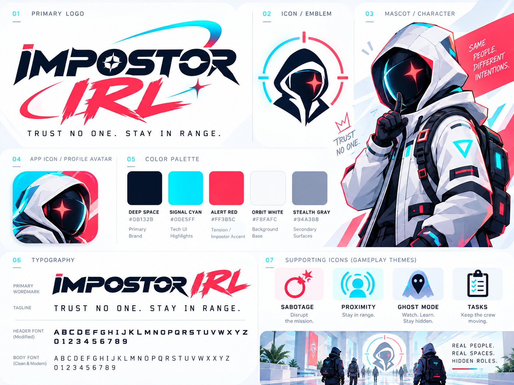

# Impostor IRL: visual direction

Use the supplied brand board as the reference for the PWA, host screen, emergency button, and simulator. Generated artwork and implemented screens follow this direction; see [asset provenance](docs/ASSETS.md).

The later [activity mockup](assets/mobile-tasks-reference.png) and [meeting mockup](assets/mobile-meeting-reference.png) refine the mobile game direction: light full-screen scenes, bold cyan/red game accents, illustrated characters, and tactile puzzle controls. The game has no administrative heading or results table. Mockup-only features (chat, XP, levels, maps) are outside scope.

## Identity

- Name: **Impostor IRL**.
- Tagline: **Trust no one. Stay in range.**
- Futuristic field equipment, hooded space-operative imagery, clean light surfaces, dark navy text, cyan signals, and red alert accents.
- Use angular headings and restrained orbital/range motifs. Keep body text simple and readable.
- Use the hooded mascot in the lobby, role reveal, and round result. Keep puzzle screens focused on the activity.

## Palette from the reference

| Token | Color | Use |
| --- | --- | --- |
| Deep space | `#0B132B` | Primary text, strong controls, dark panels |
| Signal cyan | `#00E5FF` | Signal/presence indicators, focus, active connections |
| Alert red | `#FF3B5C` | Kill, emergency, sabotage, urgent feedback |
| Orbit white | `#F8FAFC` | Main background and light surfaces |
| Stealth gray | `#94A3B8` | Borders, secondary surfaces, supporting decoration |

Check contrast when implementing: use navy text on cyan controls and sufficiently dark text for small labels on light surfaces. Color must be accompanied by labels, icons, or shapes, especially in wires and pattern activities.

## Screens

- **Player:** A mobile-only game layout, capped at 480px even in desktop preview. Large touch targets, colored operative portraits, a clear task list, obvious scan/nearby interactions, and a fixed report/kill action area. Keep impostor actions private to that player's screen.
- **Activities:** One focused puzzle per screen, shared title/progress/cancel layout, minimal decoration around the interaction. Each of the seventeen activities has its own visual module within this common shell.
- **Role/death/meeting:** Clear full-screen state changes with short instructions. Use both text and visuals to distinguish states.
- **Emergency PC/tablet:** One oversized red emergency control with phase/cooldown feedback. Readable from a standing position.
- **Host:** Clear lobby/configuration controls, connection status, and round control. Match the brand without hiding useful information behind decoration.
- **Simulator:** Practical presence toggles and virtual devices, using the same colors/icons as the player screens. Clearly label simulated inputs.

## UI modularity

Share buttons, panels, typography, status indicators, and the activity shell. Keep interaction selection separate from the game screen: QR scanning and a nearby-target list both return a target to the same kill confirmation or task launcher.

The design reference contains future concepts such as sabotage. Their appearance in the artwork does not add them to the first release's gameplay scope.
