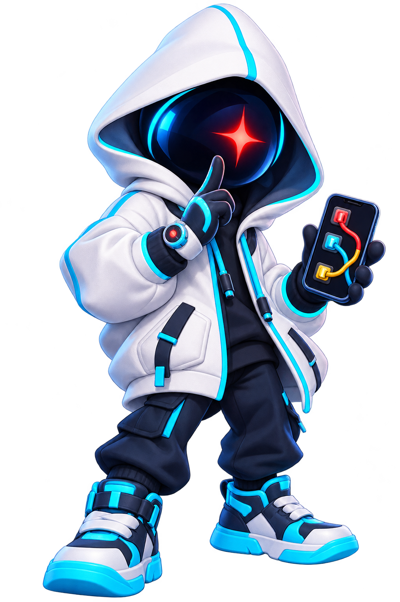
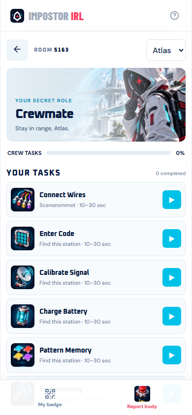
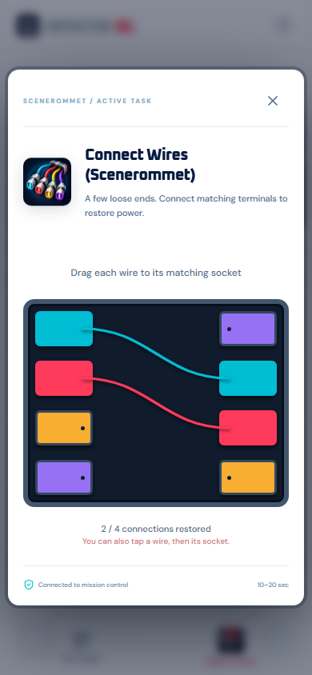
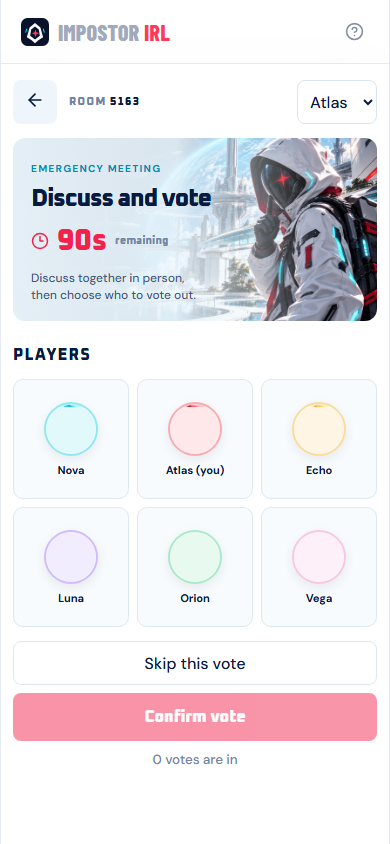

<div align="center">
  
  <h1>IMPOSTOR IRL</h1>
  <p><strong>Trust no one. Stay in range.</strong></p>
  <p>Your room becomes the map. Your friends become the crew.<br>Your phone holds your secret role.</p>
  <p>
    
    
    
    
  </p>
  <p><a href="#play-tonight">Quick start</a> · <a href="docs/DEPLOY-AND-PLAY.md">Deploy & play</a> · <a href="docs/PREVIEW.md">Try it solo</a> · <a href="docs/HARDWARE.md">Hardware roadmap</a></p>
</div>

---

**Real people. Real spaces. Hidden roles.**

Crewmates move between real locations to complete quick phone activities. Impostors blend in, scan player badges to eliminate targets, and try to survive the next vote. A body stays where the player falls. Meetings happen together, face to face.

Start with QR codes and phones. Preview the whole game alone. Add physical beacons later through the same proximity interface.

> **Software prototype:** the browser game, Rust server, QR flow and simulator are implemented. ESP32 firmware, PCBs and UWB integration are future work. One live room runs in memory, with no database.

## A look inside

<p align="center">
  
  
  
</p>
<p align="center"><sub>Actual browser screens. Mascot and game illustrations are AI-generated artwork.</sub></p>

## Your space is the game board

- **Your group, your rules.** Set player and impostor counts, timers and activities per player. No fixed player cap; crew must outnumber impostors at the start.
- **A game in your pocket.** Private roles, colored avatars, animated puzzles, body reports, voting and ghost tasks.
- **Real locations.** Put Connect Wires in Scenerommet and another copy in the kitchen. Each placement has its own QR and independent progress.
- **Print and play.** Join codes, player badges and station QR sheets, with individual PNG downloads.
- **Easy rejoining.** Reopen the page to resume, or reclaim your player with the same name and room code.
- **Gather the crew.** A shared PC/tablet emergency button with an optional meeting horn.
- **Test alone.** Six virtual players, role switching, simulated proximity and badge feedback. Six is a demo preset, not a player limit.

### Seventeen pocket-sized activities

| Activity | Your job |
| --- | --- |
| Connect Wires | Drag each wire to its matching terminal. |
| Enter Code | Remember a briefly displayed code. |
| Calibrate Signal | Tune to a target frequency and hold steady. |
| Charge Battery | Capture the moving indicator in the charge window. |
| Pattern Memory | Repeat a flashing sequence. |
| Find Anomaly | Spot the symbol that does not belong. |
| Align Circuits | Rotate tiles to connect the circuit. |
| Crack Password | Solve clues to discover a PIN. |
| Chemical Mixing | Balance two ingredients and stabilize the mixture. |
| Data Transfer | Follow a moving receiver to upload data. |
| Find the Fault | Identify a relay with an irregular heartbeat. |
| Frequency Hunt | Follow pulses to a hidden frequency. |
| Code Breaker | Use exact/misplaced digit feedback to crack a lock. |
| Timing Challenge | Catch a narrow timing window several times. |
| Route the Power | Rotate pieces to route power to the outlet. |
| Switch Sequence | Flip switches in the required order. |
| Cargo Sorting | Swipe deliveries into the correct bay. |

## Play tonight

Install **current stable Rust** and **Node.js 22+**, then run from the checkout:

```sh
npm --prefix web ci
npm run build
npm start
```

Host: **http://localhost:3001/host**. Player entry: **http://localhost:3001/**.

For phones, replace localhost with a reachable server address or use the HTTPS tunnel below. Localhost on a phone means the phone itself.

1. Set player/role counts, activities per player, timers and QR interaction modes in `/host`. Save settings.
2. Give placements real location names. In `/print`, set the reachable game address and print join/station codes.
3. Friends join on their phones with the room code and distinct names. Print player badges after they join.
4. Open `/emergency` on a shared screen; enable and test the horn if wanted.
5. Start the mission. Crew complete assigned tasks; impostors scan badges to kill. Report bodies, gather in person and vote on phones.
6. Use **Reset game** at the top of a host page to edit setup for the next round.

Crew win by completing assigned work or eliminating every impostor. Impostors win when they reach parity with living crew.

**Keep the server running.** Restarting loses the room and game state; resetting through the UI keeps players and placements. Phone cameras and PWA installation need trusted HTTPS. Manual printed-code entry also works.

### Share over HTTPS with Cloudflare Tunnel

Install [cloudflared](https://developers.cloudflare.com/tunnel/downloads/). With the game running, open another terminal:

```sh
cloudflared tunnel --url http://localhost:3001
```

Share the printed HTTPS URL with friends. Open that URL plus `/host` yourself, and enter it in `/print` before printing the join QR. Keep both processes running.

Quick Tunnel addresses change when recreated. For repeat game nights and reusable join cards, use a named tunnel with a permanent hostname pointing to `http://localhost:3001`. See [Quick Tunnels](https://developers.cloudflare.com/tunnel/get-started/quick-tunnels/) and [permanent tunnel setup](https://developers.cloudflare.com/tunnel/get-started/).

> Host pages and APIs are unauthenticated in this trusted-friends release. Player screens have no host links, but anyone who knows the URLs can open them. A tunnel does not add a host password.

## No friends nearby? Test alone

Open **`/dashboard` directly** and choose **Try solo demo**. Switch virtual operatives to test roles, kills and voting. Practice any puzzle at `/activities`; fake nearby players and inspect device feedback at `/simulator`.

For development:

```sh
npm run dev
```

This starts Rust on **3001** and Vite on **5173**. Stop previous instances first if the ports are occupied. For game night, use the single-server production build above.

| URL | Purpose |
| --- | --- |
| `/` or `/join` | Player entry and rejoining |
| `/host` | Host setup, start and reset |
| `/dashboard` | Host overview and solo demo |
| `/activities` | Practice every activity |
| `/simulator` | Virtual proximity and badge feedback |
| `/print` | Join, player and station QR sheets |
| `/emergency` | Shared meeting button and horn |

## Small pieces, one game

```text
Phones / PWA ── HTTP + WebSocket ── Rust server
                                      │
                              Pure Rust game rules
                                      │
                     QR / simulated proximity today
                     ESP32 / BLE / UWB adapters later
```

| Piece | Responsibility |
| --- | --- |
| `crates/game` | Roles, assignments, kills, meetings, victory and puzzle validation |
| `crates/protocol` | Shared commands, settings and interaction types |
| `crates/server` | HTTP/WebSocket transport, sessions, proximity expiry and feedback |
| `web` | React/TypeScript PWA, mobile minigames, QR and host screens |

The server decides whether an action succeeds. The interaction source supplies QR or proximity input; game rules do not depend on a particular radio.

## Hardware, when we are ready

Planned ESP32 wearables report proximity and vibrate when a player is killed or a meeting starts. Activity stations expose buttons, knobs, lights and other GPIO inputs. A physical emergency button uses the same command as the browser station.

The [hardware specification](docs/HARDWARE.md) covers wearable/station responsibilities, power and I/O, presence filtering, feedback and a later UWB adapter. This release ships software only.

## Checks and documentation

```sh
npm test
npm --prefix web run build
npm run test:smoke
cargo fmt --all -- --check
```

Current checks cover **26 Rust tests** and **six frontend utility tests**. The isolated HTTP smoke test covers all seventeen activities, repeated stations, rejoining, privacy, voting and an **80-player / 12-impostor** round. Browser validation has exercised all seventeen real puzzles. Physical cameras and future hardware still need device testing.

- [Deploy and play](docs/DEPLOY-AND-PLAY.md) — Wi-Fi, HTTPS, printing and game-night walkthrough.
- [Preview guide](docs/PREVIEW.md) — solo testing, rejoining and routes.
- [Multiplayer playthrough](docs/MULTIPLAYER-TEST.md) — five live sessions across four complete rounds.
- [Validation report](docs/VALIDATION.md) — checks and their limits.
- [Architecture](ARCHITECTURE.md) · [API contract](IMPLEMENTATION-CONTRACT.md) · [Backend notes](BACKEND-NOTES.md).
- [Artwork and fonts](docs/ASSETS.md) — provenance, prompts and bundled font licenses.

<p align="center"><strong>Same people. Different intentions.</strong></p>
